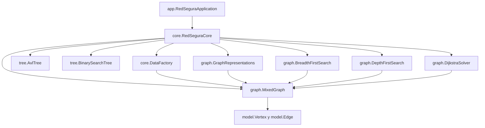

# RedSegura Sincelejo

Parcial 2 de Estructura de Datos II (2026). Aplicación de consola en Java 17 que modela
la movilidad entre 12 lugares de Sincelejo con árboles (ABB y AVL) y grafos
(BFS, DFS y Dijkstra). Los tiempos son datos didácticos de simulación, no oficiales.

Autor: Juan Contreras

## Cómo ejecutar

Requisitos: JDK 17, Apache NetBeans (con Maven integrado) y conexión a internet la primera vez
para descargar JUnit.

1. Clonar: `git clone https://github.com/juancontrer48-debug/redsegura.git`
2. En NetBeans: File > Open Project y elegir la carpeta clonada.
3. Clean and Build (debe terminar en BUILD SUCCESS).
4. Pruebas: clic derecho en el proyecto > Test (66 pruebas, 0 fallos).
5. Aplicación: clic derecho en `RedSeguraApplication.java` > Run File.
6. Medición: clic derecho en `Benchmark.java` > Run File.

## Arquitectura

- `model`: `Vertex` y `Edge` inmutables, con validación de datos (peso > 0, textos no vacíos).
  `Edge` tiene el estado `blocked`.
- `graph`: `MixedGraph` (aristas y arcos), representaciones y algoritmos.
- `tree`: ABB y AVL genéricos con contador de pasos de búsqueda.
- `core`: `RedSeguraCore` (fachada) y `DataFactory` (12 lugares y 18 conexiones).
- `app`: consola con las consultas Q1 a Q7 y `Benchmark`.

La aplicación solo habla con `RedSeguraCore`. Ningún módulo lee campos privados de otro.

## Decisiones de diseño

- Las aristas no dirigidas se guardan en las listas de ambos extremos (mismo objeto `Edge`).
  Los arcos dirigidos, solo en la del origen.
- `LinkedHashMap` conserva el orden: vértices S01 a S12 y conexiones R01 a R18. Las tres
  representaciones usan el mismo orden.
- Matriz de adyacencia: 0 significa "sin conexión" (los pesos siempre son mayores que 0).
- Matriz de incidencia: arco = -1 en el origen y +1 en el destino; arista = +1 en ambos extremos.
- Las representaciones muestran la estructura completa, incluso las conexiones bloqueadas.
  Los algoritmos sí ignoran las bloqueadas.
- Altura: árbol vacío = -1, un nodo = 0.
- Las claves duplicadas se ignoran en ABB y AVL.

## Resultados de control

- Ruta mínima S02 a S08: 24 minutos, camino S02, S01, S07, S08 (R04, R01, R16).
- Existe otra ruta de igual costo: S02, S01, S09, S10, S08 (8+5+3+8 = 24).
- Desempate de Dijkstra: la relajación usa `<` estricto, así que se conserva el primer
  camino encontrado.
- Q6: al bloquear R16 el costo sigue en 24 y el camino cambia a la ruta por S09 y S10.
- Q7: un vértice inexistente lanza `IllegalArgumentException`, que la aplicación atrapa
  sin terminar.

## Complejidad

| Estructura u operación | Tiempo | Espacio |
|---|---|---|
| ABB insert, search, delete | O(h); peor caso O(n) | O(n) |
| AVL insert, search, delete | O(log n) | O(n) |
| Recorridos de árbol | O(n) | O(h) por recursión |
| BFS y DFS (lista de adyacencia) | O(V + E) | O(V) |
| Dijkstra con PriorityQueue | O((V + E) log V) | O(V) |
| Lista de adyacencia | construcción O(V + E) | O(V + E) |
| Matriz de adyacencia | construcción O(V² + E) | O(V²) |
| Matriz de incidencia | construcción O(V·E) | O(V·E) |

## Medición (un computador, una corrida; varía entre ejecuciones)

Inserción de n claves en orden creciente y búsqueda de la última (`Benchmark`):

| n | ABB insert (ms) | AVL insert (ms) | ABB pasos | AVL pasos |
|---|---|---|---|---|
| 1000 | 20 | 25 | 1000 | 10 |
| 5000 | 69 | 5 | 5000 | 13 |
| 10000 | 235 | 6 | 10000 | 14 |
| 20000 | 931 | 18 | 20000 | 15 |

Con datos ordenados el ABB se degenera en lista (búsqueda O(n), inserción total O(n²)),
mientras que el AVL se mantiene en O(log n). El valor de 1000 en el AVL incluye el
calentamiento de la JVM.

## Pruebas

JUnit 5: 66 pruebas (modelo, grafo, representaciones, BFS/DFS, Dijkstra, ABB, AVL e
integración). Cubren casos normales, vértice inexistente, IDs duplicados, pesos inválidos,
grafo desconectado y bloqueo de conexiones.
